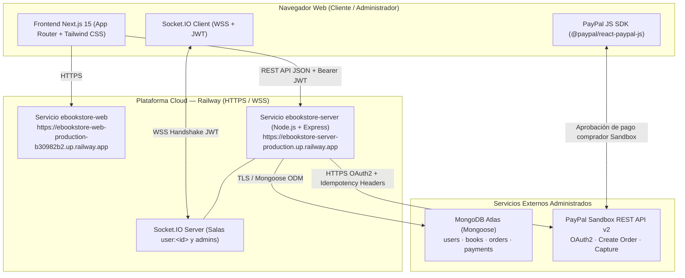
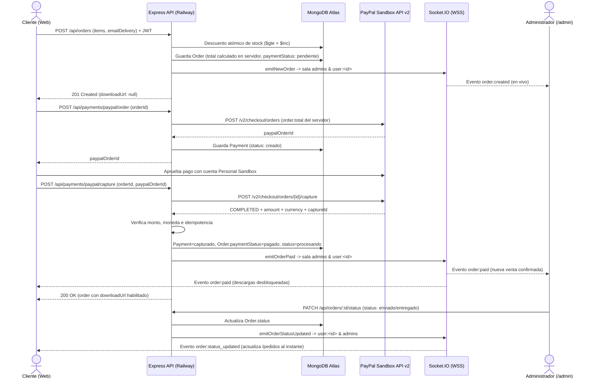

# Arquitectura del Sistema y Justificación Técnica — eBookStore

Este documento describe la arquitectura *full-stack* de **eBookStore**, su topología de despliegue en la nube, los flujos de datos críticos y la justificación técnica de cada tecnología seleccionada.

---

## 1. Diagrama de Arquitectura General

---

## 2. Flujo de Secuencia: Compra, Pago PayPal e Interacción en Tiempo Real

---

## 3. Justificación del Stack Tecnológico

| Tecnología | Rol en el Proyecto | Justificación Técnica |
| :--- | :--- | :--- |
| **Next.js 15 (App Router) + Tailwind CSS** | Frontend (`lab5/web`) | Permite estructurar vistas modulares (`/`, `/auth`, `/carrito`, `/pedidos`, `/admin`) con generación optimizada de bundles, enrutamiento declarativo, carga rápida y estilos utilitarios consistentes y responsivos sin sobrecarga de CSS manual. |
| **Node.js + Express** | Backend API REST (`lab5/server`) | Entorno asíncrono ideal para I/O intensivo (consultas a MongoDB Atlas, llamadas HTTP a PayPal y manejo concurrente de peticiones). Express facilita una arquitectura limpia por capas (rutas, controladores, middlewares de seguridad y manejo centralizado de errores). |
| **MongoDB Atlas + Mongoose** | Base de Datos Documental | El modelo documental encaja naturalmente con pedidos que embeben snapshots de ítems comprados (`items[]` con precio unitario y título al momento de compra), garantizando consistencia histórica aunque cambie el precio del catálogo. Mongoose aporta validación de esquemas, índices y operaciones atómicas (`findOneAndUpdate` con `$gte` + `$inc`) para evitar sobreventa. |
| **PayPal Sandbox (REST API v2 + JS SDK)** | Pasarela de Pagos | Separa la experiencia de aprobación en el navegador (`@paypal/react-paypal-js`) de la creación y captura autoritativa en el servidor. Permite validar montos, moneda y `captureId` fuera del alcance del cliente, incorporando cabeceras `PayPal-Request-Id` para idempotencia y pruebas seguras sin dinero real. |
| **Socket.IO** | Comunicación en Tiempo Real | Provee mensajería bidireccional de baja latencia sobre `WSS` (con respaldo automático a *long-polling*), autenticación en el *handshake* mediante JWT y segmentación por salas (`user:<id>` y `admins`), eliminando la necesidad de *polling* constante para monitorear nuevas ventas y cambios de estado. |
| **Railway** | Despliegue Cloud (PaaS) | Simplifica el despliegue independiente de los dos servicios del monorepo (`ebookstore-server` y `ebookstore-web`) con certificados HTTPS/WSS automáticos, inyección segura de variables de entorno, monitoreo de salud (`/health`) y despliegues rápidos mediante CLI (`railway up`). |
| **TestSprite** | Pruebas Automatizadas E2E | Genera y ejecuta suites de pruebas *end-to-end* guiadas por un `PRD.md` directamente contra el entorno desplegado en producción, detectando defectos reales de integración (como inyección de variables en build y búsquedas sin tildes). |

---

## 4. Decisiones Clave de Seguridad e Integridad

1. **Verdad única en el servidor:** El total del pedido (`Order.total`) y los montos enviados a PayPal se calculan siempre a partir de los precios en MongoDB, ignorando cualquier monto enviado desde el navegador.
2. **Control atómico de inventario:** `POST /api/orders` descuenta licencias mediante `findOneAndUpdate({ _id, stock: { $gte: qty } }, { $inc: { stock: -qty } })` con rollback compensatorio si falla algún ítem, y `PATCH /api/orders/:id/status` restaura stock al cancelar.
3. **Protección de propiedad digital:** `downloadUrl` nunca se expone en el catálogo público (`GET /api/books`) ni en pedidos impagos (`paymentStatus !== 'pagado'`).
4. **Defensa en profundidad:** Contraseñas hasheadas con `bcryptjs`, JWT con verificación contra BD, RBAC estricto (`cliente` vs. `administrador`), `helmet`, sanitización contra NoSQL Injection (`$`/`.`), validación de esquemas `http(s)://` contra XSS y limitación de tasa (*rate limiting*).
