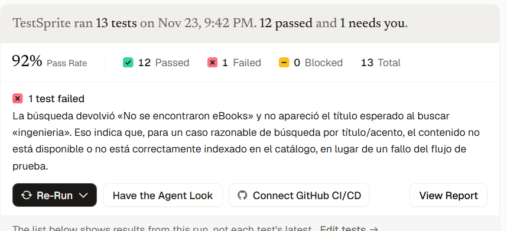

# Informe de Laboratorio: Generación de Aplicaciones Full-Stack con Inteligencia Artificial — eBookStore

**Responsable:** José Luis Gil García  
**C.C.:** 1034988407  
**Correo institucional:** j.gil@udea.edu.co  
**Asignatura:** Fundamentos en Sistemas de Información — Universidad de Antioquia (2026)  
**Profesor:** Diego José Luis Botía  
**Enlace al repositorio de GitHub:** [https://github.com/JoseGG8/FSI_labs/tree/main](https://github.com/JoseGG8/FSI_labs/tree/main)  
**Carpeta de la práctica en GitHub:** [https://github.com/JoseGG8/FSI_labs/tree/main/lab5](https://github.com/JoseGG8/FSI_labs/tree/main/lab5)  
**Aplicación en producción (Railway):**
* **Frontend (Tienda Web):** [https://ebookstore-web-production-b30982b2.up.railway.app](https://ebookstore-web-production-b30982b2.up.railway.app)
* **Backend (API y Tiempo Real):** [https://ebookstore-server-production.up.railway.app](https://ebookstore-server-production.up.railway.app)
* **Estado del servicio:** [https://ebookstore-server-production.up.railway.app/health](https://ebookstore-server-production.up.railway.app/health)

**Documentación técnica de apoyo:**
* **Guía de ejecución y resumen:** [README.md](https://github.com/JoseGG8/FSI_labs/blob/main/lab5/README.md)
* **Diagrama de arquitectura y justificación:** [ARQUITECTURA.md](https://github.com/JoseGG8/FSI_labs/blob/main/lab5/ARQUITECTURA.md)
* **Documentación de modelos, API y WebSockets:** [DOCUMENTACION_API.md](https://github.com/JoseGG8/FSI_labs/blob/main/lab5/DOCUMENTACION_API.md)
* **Auditoría de seguridad:** [AUDITORIA_SEGURIDAD.md](https://github.com/JoseGG8/FSI_labs/blob/main/lab5/AUDITORIA_SEGURIDAD.md)
* **Documento de requisitos para pruebas (PRD):** [PRD.md](https://github.com/JoseGG8/FSI_labs/blob/main/lab5/PRD.md)

---

## 1. Introducción

Construir una aplicación web completa con apoyo de inteligencia artificial va mucho más allá de pedir fragmentos de código. Exige definir con claridad los requisitos del negocio, acordar una arquitectura coherente, trabajar por entregas verificables, cuidar la seguridad de los datos y validar el producto real en la nube antes de liberarlo.

En esta práctica de laboratorio diseñé, implementé, probé y desplegué **eBookStore**, una plataforma de comercio electrónico dedicada a la **venta de libros electrónicos (eBooks)**, gestión de catálogo e inventario digital y administración de envíos en tiempo real. A partir de los lineamientos del curso, el desarrollo se organizó en fases progresivas separando la interfaz web del servidor de negocio, conectando una base de datos en la nube, integrando pagos simulados verificados desde el servidor, habilitando notificaciones instantáneas entre cliente y administrador y ejecutando pruebas automatizadas sobre el sistema desplegado.

---

## 2. Objetivos

### 2.1. Objetivo General
Desarrollar, validar, documentar y desplegar en la nube una aplicación web *full-stack* para la venta de libros electrónicos, integrando herramientas de desarrollo asistido por inteligencia artificial, pagos en línea seguros, comunicación en tiempo real y pruebas automatizadas.

### 2.2. Objetivos Específicos
* **Traducir una necesidad de negocio en un plan estructurado:** Organizar el proyecto por fases verificables antes de generar código, definiendo actores, permisos y límites de confianza.
* **Desacoplar la interfaz de usuario del servidor de negocio:** Mantener la presentación web separada del servidor encargado de la seguridad, el cálculo de precios, el control de stock y los pagos.
* **Persistir la información en la nube:** Configurar una base de datos administrada y conectarla mediante variables de entorno sin exponer credenciales en el repositorio.
* **Implementar pagos confiables y seguimiento en tiempo real:** Validar los cobros en PayPal Sandbox desde el servidor y reflejar al instante las ventas y cambios de estado del pedido tanto al cliente como al administrador.
* **Desplegar y probar el sistema en un entorno público:** Publicar frontend y backend en Railway, auditar aspectos básicos de seguridad y evaluar el funcionamiento mediante una suite automatizada en TestSprite.

---

## 3. Herramientas y Tecnologías Utilizadas

A continuación se resumen las herramientas empleadas en el proyecto, explicando qué es cada una, para qué se utilizó y por qué resultó adecuada para esta solución:

* **Antigravity:** Entorno de desarrollo asistido por inteligencia artificial. Se utilizó para planificar las fases, generar el código del frontend y el backend, revisar hallazgos de seguridad y diagnosticar errores durante el despliegue. Se eligió porque permite avanzar de forma ordenada e iterativa sin perder el control sobre cada decisión técnica.
* **Next.js:** Marco de trabajo para construir aplicaciones web modernas. Se utilizó para crear todas las vistas de la tienda (catálogo, inicio de sesión, carrito, historial de compras y panel administrativo). Se eligió porque facilita organizar las rutas de la aplicación y entrega una interfaz rápida y bien estructurada.
* **Tailwind CSS:** Herramienta de estilos basada en clases utilitarias. Se utilizó para diseñar la apariencia visual y asegurar que la tienda se adapte bien a computador y celular. Se eligió porque agiliza el diseño visual manteniendo coherencia sin escribir hojas de estilo extensas.
* **Node.js y Express:** Entorno de ejecución y marco ligero para servidores web. Se utilizaron para construir el servidor que centraliza la API, la autenticación, el control de inventario y la comunicación con servicios externos. Se eligieron porque permiten trabajar todo el proyecto en el mismo lenguaje y separar con claridad las reglas de negocio del navegador.
* **MongoDB Atlas (con Mongoose):** Servicio de base de datos en la nube orientado a documentos. Se utilizó para almacenar usuarios, libros electrónicos, pedidos y pagos. Se eligió porque su estructura flexible se adapta muy bien a pedidos con múltiples libros y no requiere administrar infraestructura local.
* **PayPal Sandbox:** Entorno oficial de pruebas de la pasarela de pagos PayPal. Se utilizó para simular compras completas de eBooks sin dinero real, verificando cada pago directamente desde el servidor. Se eligió porque replica un flujo de pago comercial real y permite validar seguridad antes de salir a producción.
* **Socket.IO:** Librería para comunicación bidireccional en tiempo real sobre WebSockets. Se utilizó para notificar nuevas ventas al panel administrativo y actualizar el estado del envío en la vista del cliente sin recargar la página. Se eligió porque se integra en el mismo servidor del backend y facilita restringir canales según el rol del usuario.
* **Railway:** Plataforma en la nube para publicar aplicaciones y servidores. Se utilizó para alojar de forma independiente el frontend y el backend con direcciones públicas seguras. Se eligió porque simplifica la configuración de variables de entorno, la revisión de registros y el despliegue directo de las carpetas del proyecto.
* **TestSprite:** Plataforma de pruebas automatizadas asistida por inteligencia artificial. Se utilizó para recorrer la aplicación publicada en Railway a partir del documento de requisitos y detectar errores reales. Se eligió porque permite validar múltiples flujos de usuario rápidamente sobre el entorno en producción.
* **Git y GitHub:** Sistema de control de versiones y repositorio en la nube. Se utilizaron para guardar el historial del proyecto y entregar el código junto con la documentación sin incluir archivos privados.

---

## 4. Metodología y Procedimiento

El trabajo se desarrolló de manera incremental en fases acotadas, validando cada componente antes de pasar al siguiente:

```text
┌────────────────────────────────────────────────────────────────────────────┐
│                   FLUJO DE CONSTRUCCIÓN DE EBOOKSTORE                      │
├────────────────────┬────────────────────┬──────────────────────────────────┤
│ 1. PLANIFICACIÓN   │ 2. BACKEND Y DATOS │ 3. PAGOS Y TIEMPO REAL           │
│    Monorepo y      │    Express, Atlas, │    PayPal Sandbox verificado     │
│    arquitectura    │    auth y stock    │    en servidor + Socket.IO       │
└─────────┬──────────┴─────────┬──────────┴────────────────┬─────────────────┘
          │                    │                           │
          ▼                    ▼                           ▼
┌────────────────────┬────────────────────┬──────────────────────────────────┐
│ 4. FRONTEND WEB    │ 5. DESPLIEGUE      │ 6. SEGURIDAD Y QA                │
│    Catálogo, carro,│    Frontend y API  │    Auditoría básica, PRD y       │
│    /pedidos, /admin│    en Railway      │    pruebas E2E con TestSprite    │
└────────────────────┴────────────────────┴──────────────────────────────────┘
```

### 4.1. Arquitectura y límites de confianza
Desde el inicio se definió una estructura monorepo dentro de `lab5/` dividida en `web/` (interfaz) y `server/` (lógica de negocio y tiempo real). La regla central de diseño fue no confiar en el navegador para decisiones sensibles: el cliente nunca define el precio final, nunca marca un pedido como pagado por su cuenta ni puede cambiar estados reservados al administrador. Toda validación crítica vive en el servidor.

```text
Navegador (Cliente / Administrador)
 ├── HTTPS ───────────────▶ Next.js (Frontend en Railway)
 └── HTTPS/REST + WSS ────▶ Node.js + Express + Socket.IO (Backend en Railway)
                              ├── MongoDB Atlas (users, books, orders, payments)
                              └── PayPal Sandbox (creación y captura de pagos)

TestSprite ───────────────▶ URL pública del Frontend y Backend en Railway
```

### 4.2. Modelado de datos y conexión con MongoDB Atlas
Se diseñaron cuatro colecciones principales acordes al negocio de eBooks:
* **`users`:** almacena nombre, correo, contraseña cifrada con hash (nunca en texto plano) y rol (`cliente` o `administrador`).
* **`books`:** almacena título, autor, descripción, categoría, precio, stock de licencias digitales, portada y enlace privado de descarga.
* **`orders`:** guarda la referencia al usuario, el detalle de los libros comprados con su precio al momento de la compra, el total recalculado en el servidor, el correo de entrega digital, el estado del pedido (`pendiente`, `procesando`, `enviado`, `entregado`, `cancelado`) y el estado de pago.
* **`payments`:** registra cada intento de pago con PayPal, su identificador de orden, identificador de captura, monto y estado para evitar cobros duplicados.

Para agilizar las pruebas se creó un script de carga inicial (`seed`) con 8 libros electrónicos repartidos en 6 categorías y dos cuentas de demostración (`cliente@ebookstore.com` y `admin@ebookstore.com`). Tras crear el clúster gratuito en MongoDB Atlas y configurar el acceso de red, se verificó la conexión mediante la variable `MONGODB_URI` en el archivo `.env` local (excluido de Git).

### 4.3. Autenticación, control de stock, PayPal Sandbox y tiempo real
* **Autenticación y roles:** el registro público crea únicamente cuentas de tipo `cliente`. El inicio de sesión valida la contraseña cifrada y entrega un token que protege las rutas privadas y restringe el panel de administración.
* **Control de inventario y precios:** al confirmar un pedido, el servidor consulta los precios reales en base de datos, recalcula el total y descuenta el stock de manera controlada para evitar sobreventa. Si un administrador cancela un pedido, las licencias vuelven automáticamente al inventario.
* **Pagos con PayPal Sandbox:** al iniciar el pago, el servidor solicita la orden a PayPal usando el total calculado internamente. Una vez el comprador aprueba en la ventana de PayPal, el servidor ejecuta la captura, verifica que el estado sea completado, comprueba que el monto y la moneda coincidan y valida que el pago no haya sido aplicado antes. Solo en ese momento se marca el pedido como pagado y se habilitan los enlaces de descarga digital.
* **Notificaciones en tiempo real:** al conectarse, cada usuario presenta su token en Socket.IO y el servidor lo ubica automáticamente en su sala privada; los administradores ingresan además a una sala general de ventas. Así, cuando se confirma una compra, aparece de inmediato en `/admin`, y cuando el administrador cambia el estado de envío, el cliente lo ve reflejado al instante en `/pedidos`.

### 4.4. Interfaz web y validación local
En `web/` se construyeron cinco vistas principales: catálogo con búsqueda y filtros (`/`), acceso y registro (`/auth`), carrito y pago con los botones de PayPal (`/carrito`), historial y descargas (`/pedidos`) y panel administrativo de pedidos e inventario (`/admin`). Antes de subir a la nube se probó el flujo completo en local usando dos ventanas simultáneas (cliente y administrador) y una cuenta comprador de PayPal Sandbox, comprobando la compra, el descuento de stock y las actualizaciones en vivo.

### 4.5. Despliegue en Railway y resolución de incidencias
Para publicar únicamente la práctica `lab5` sin involucrar los laboratorios anteriores del repositorio, se utilizaron servicios separados en Railway desplegados desde las carpetas `lab5/server` y `lab5/web` con archivos `.railwayignore` para no subir dependencias ni secretos. Durante el despliegue surgieron tres retos prácticos que se diagnosticaron y corrigieron:
1. **Servicios en borrador:** al crear servicios vacíos en Railway, primero debían aplicarse los cambios en el entorno de producción para poder subir el código desde la terminal.
2. **Puerto del dominio y variables públicas:** el dominio inicial del frontend apuntaba a un puerto distinto al que usaba Next.js y las variables públicas necesitaban el prefijo adecuado y el protocolo `https://`.
3. **Reconstrucción del frontend:** tras ajustar las variables públicas de Next.js, fue necesario generar un nuevo despliegue para que el paquete final quedara compilado con la dirección correcta del backend y el identificador de PayPal.

### 4.6. Revisión de seguridad y pruebas automatizadas en TestSprite
Antes de finalizar se revisaron controles de seguridad básicos sobre el código y la configuración en la nube: protección contra inyecciones en consultas, limitación de peticiones repetidas para evitar abuso en el login, validación de enlaces para prevenir código malicioso en portadas o descargas, ocultamiento de enlaces de descarga en pedidos no pagados y paso del backend a modo producción para no exponer detalles internos ante errores.

Posteriormente se elaboró el archivo `PRD.md` describiendo las rutas, roles, credenciales de prueba y comportamientos esperados, y se creó una suite de tipo *Live Web App* en **TestSprite** apuntando a la URL pública de Railway.

---

## 5. Resultados Obtenidos

### 5.1. Aplicación funcional en producción
La plataforma quedó desplegada y operativa en Railway con soporte HTTPS y WebSockets seguros:
* **Catálogo público (`/`):** carga los 8 libros iniciales, permite filtrar por categoría, disponibilidad y orden, y oculta las rutas de descarga al público.
* **Carrito y checkout (`/carrito`):** reserva inventario en servidor, integra los botones de PayPal Sandbox y libera las descargas únicamente tras validar la captura del pago.
* **Mis Libros (`/pedidos`):** muestra el historial propio del cliente, bloquea descargas en pedidos pendientes y refleja en vivo los cambios de estado hechos por el administrador.
* **Panel administrativo (`/admin`):** accesible solo para administradores, muestra indicadores de ventas, recibe nuevos pedidos en tiempo real, permite cambiar el estado de envío y editar o agregar eBooks al catálogo.

### 5.2. Resultados de pruebas automatizadas (TestSprite)

En una primera revisión diagnóstica, TestSprite detectó que el paquete inicial del frontend conservaba la dirección de la API sin `https://` y sin el identificador público de PayPal inyectado. Se agregó normalización defensiva de direcciones en el cliente y se redesplegó el frontend, quedando el sitio completamente operativo.

En la ejecución completa de la suite de pruebas sobre la aplicación desplegada (23 de noviembre de 2026) se obtuvieron los siguientes resultados:

| Indicador | Resultado |
| :--- | :---: |
| **Total de pruebas ejecutadas** | **13** |
| **Pruebas aprobadas** | **12** |
| **Pruebas fallidas** | **1** |
| **Pruebas bloqueadas** | **0** |
| **Tasa de aprobación** | **92%** |



* **Defecto detectado y corregido:** el único caso fallido ocurrió al buscar la palabra `"ingenieria"` sin tilde en el catálogo, pues no coincidía con el título `"Ingeniería de Prompts y Agentes de IA en Producción"`. Se corrigió el buscador en el backend para que ignore tildes y diferencias de `ñ` tanto en título, autor y descripción como en categoría, se redesplegó en Railway y se comprobó directamente en producción que búsquedas como `ingenieria`, `sofia` y `castano` ya devuelven los resultados esperados.

### 5.3. Limitaciones conocidas
* **Entorno de pagos simulado:** la pasarela opera en modo Sandbox para pruebas académicas; pasar a ventas reales requeriría credenciales comerciales de producción y un proceso formal de verificación en PayPal.
* **Descargas de demostración:** los enlaces `downloadUrl` apuntan a rutas de ejemplo en lugar de archivos alojados en un almacenamiento privado con enlaces temporales firmados.
* **Control de tráfico en memoria:** el límite de solicitudes por dirección IP se mantiene en memoria del servidor; en un escenario con varias instancias simultáneas convendría apoyarse en un servicio externo compartido.

---

## 6. Reflexión Individual y Conclusiones

Esta práctica me dejó una muy buena impresión sobre el punto en el que se encuentra hoy el desarrollo de aplicaciones empresariales apoyado en inteligencia artificial. Siento que existe un soporte sólido a lo largo de todo el ciclo de vida del software: las herramientas emergentes basadas en IA nos ofrecen como ingenieros prácticamente todo lo del modo tradicional de desarrollo —arquitectura separada, manejo de base de datos, seguridad, pagos, tiempo real, despliegue y pruebas— pero con una velocidad increíble.

Trabajar por etapas también me ayudó a notar con claridad dónde aporta más la IA y dónde sigue siendo indispensable nuestro criterio. La asistencia aceleró enormemente la creación de la estructura del proyecto, los modelos de datos, las rutas del servidor, las vistas de la interfaz y la corrección de errores puntuales. Sin embargo, las decisiones clave y la verificación final siguieron dependiendo de mí: definir el alcance para la tienda de libros electrónicos, revisar qué avanzaba en cada pausa, crear y enlazar las cuentas y variables en MongoDB Atlas, PayPal Developer y Railway, decidir cómo desplegar únicamente `lab5` sin afectar el resto del repositorio y comprobar manualmente en el navegador que los pagos y los cambios en tiempo real realmente funcionaran como esperaba.

También fue muy valioso enfrentar errores reales de despliegue, como los puertos en Railway o la reconstrucción del frontend tras cambiar variables públicas, así como ver el aporte de TestSprite al descubrir detalles finos como la búsqueda sin tildes que fácilmente se pasan por alto en pruebas rápidas. En definitiva, estas herramientas no reemplazan el entendimiento de la arquitectura ni la responsabilidad sobre la seguridad, pero sí multiplican nuestra capacidad para construir, probar y poner en marcha soluciones completas en una fracción del tiempo habitual.
